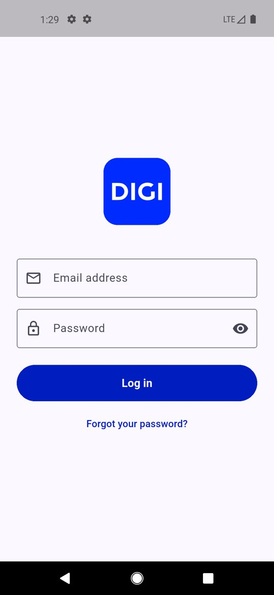
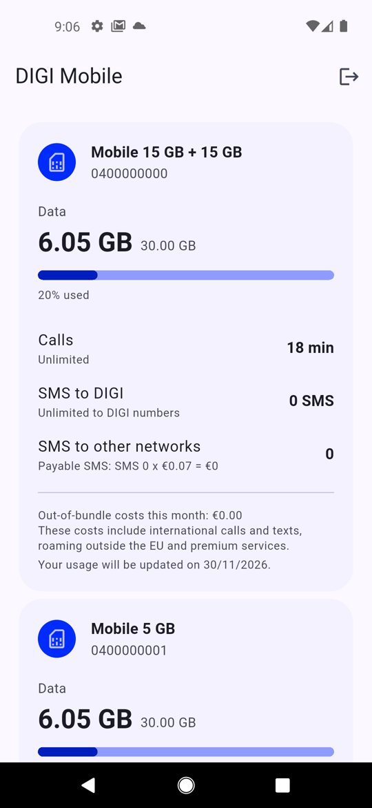
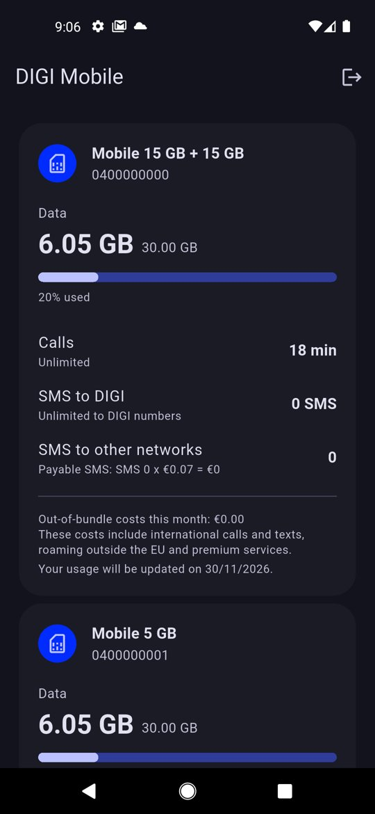

# DIGI Mobile

Unofficial Android app to follow the usage of your [DIGI Belgium](https://www.digi-belgium.be/) mobile subscriptions: data, calls and texts per product, in Dutch or English.

> This app is not made, endorsed or supported by DIGI. It logs in to the DIGI website with your email, password and the code DIGI emails you, and reads your products from the pages of My DIGI. When DIGI changes its website, the app may stop working until it is updated.

| Login | Usage | Dark mode |
| --- | --- | --- |
|  |  |  |

## How it works

- `lib/data/digi_client.dart` logs in through the same Next.js server actions as the login form on digi-belgium.be. Their ids change when DIGI rebuilds its site, so the client finds them in the login page's JavaScript (`lib/data/login_actions.dart`) at every login.
- The session cookies are kept in the device's encrypted storage (`flutter_secure_storage`); Android backups are off.
- `lib/data/products.dart` reads the products and their usage from the My DIGI pages, in the language of the app.

## Development

```sh
flutter pub get
flutter analyze   # lint, configured in analysis_options.yaml
flutter test      # feature tests against a fake DIGI serving the sanitized pages in test/fixtures
dart format .
flutter run
```

Translations live in `lib/l10n/*.arb`; run `flutter gen-l10n` after changing them. The launcher icon is generated from `assets/icon/` with `dart run flutter_launcher_icons`.

Building Android needs Java 17.

## CI and releases

- **run-tests**: every push and pull request to master runs the linter and the tests.
- **Format Dart**: formats the code and commits the result.
- **Release**: publishing a GitHub release `vX.Y.Z` lints, tests and builds the APK as version `X.Y.Z`, signs it with the key from Infisical (project ci, `/android/digi-mobile`, `DIGI_KEYSTORE_BASE64` and `DIGI_KEYSTORE_PASSWORD`) and attaches `digi-mobile.apk` to the release.
